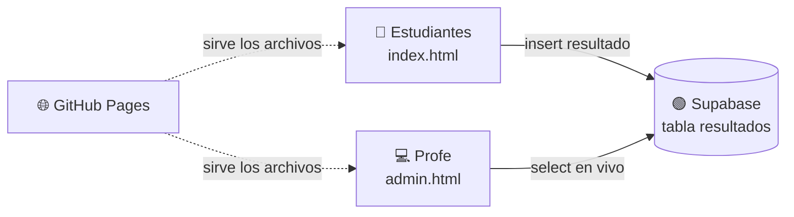

<div align="center">


# 🎯 Resortera Vectorial

### Resuelve la ecuación. Suelta la banda. Dale a la diana.

Un juego de lanzamiento para **Cálculo Vectorial** en el que la parábola no es un adorno:
es **exactamente** la curva que sale de los números que tú calculaste.

<br/>


**[▶️ Jugar](https://ketsa143.github.io/resortera-vectorial/)** · **[📊 Panel del profe](https://ketsa143.github.io/resortera-vectorial/admin.html)** · **[🚀 Despliegue](#-despliegue-en-10-minutos)**

</div>

---

## ✨ ¿Qué es?

Cada estudiante abre el link en su celular, escribe su nombre y enfrenta **10 niveles**.
En cada uno ve la escena (distancia a la torre, altura de la diana, resortera, masa, viento…),
lee la fórmula y **despeja la incógnita**. Con su respuesta, el juego lanza al pajarito
siguiendo la función vectorial real y dibuja en vivo:

<table>
<tr>
<td width="33%" align="center">🟠<br/><b>La trayectoria</b><br/><sub><code>r(t)</code></sub></td>
<td width="33%" align="center">🔵<br/><b>El vector velocidad</b><br/><sub><code>r′(t)</code>, tangente a la curva</sub></td>
<td width="33%" align="center">🔴<br/><b>El vector aceleración</b><br/><sub><code>r″(t)</code>, gravedad + viento</sub></td>
</tr>
</table>

Mientras tanto, el profe ve **en vivo** quién va ganando, qué nivel le cuesta más al grupo
y al final proyecta el **podio** para entregar el premio. 🏆

---

## 🎮 Los 10 niveles

Cada partida genera valores **al azar**, así que nadie le puede copiar al de al lado.
Todas las combinaciones están verificadas: siempre tienen solución.

| | Nivel | 🧮 El estudiante calcula | 📚 Tema del curso |
|:-:|---|---|---|
| 1️⃣ | **Calentamiento vectorial** | El ángulo `θ` | Sesión 10 · Funciones vectoriales |
| 2️⃣ | **Energía de la resortera** | El estiramiento `x` | Sesión 13 · Integral de línea y trabajo |
| 3️⃣ | **¿Qué tan elástica?** | La constante elástica `k` | Sesión 13 · Trabajo de un campo |
| 4️⃣ | **Elige tu pajarito** | La masa `m` | Sesión 13 · Trabajo y energía |
| 5️⃣ | **Muro en el camino** | `θ`, pero solo la solución alta pasa el muro | Sesión 10 · Dos soluciones de `r(t)` |
| 6️⃣ | **Desde la plataforma** | `x`, con la resortera a varios metros de altura | Sesión 10 · Funciones vectoriales |
| 7️⃣ | **Calcula el trabajo** | El trabajo `W` en joules | Sesiones 11–12 · Campos conservativos |
| 8️⃣ | **Otro planeta** | `x`, con la gravedad de la Luna 🌙, Marte 🔴 o Júpiter 🪐 | Sesión 10 · `r″(t)` |
| 9️⃣ | **Campo de viento** | `x`, con viento a favor o en contra 💨 | Sesión 11 · Campos vectoriales |
| 🔟 | **Jefe final: tiro óptimo** | `θ` **y** `x`, con bono por usar la mínima energía | Sesión 4 · Optimización |

<div align="center">

<br/><sub>Nivel 9: el viento es un campo vectorial que cambia la aceleración en x.</sub>
</div>

---

## 📐 Las matemáticas detrás

La posición del pajarito es una **función vectorial**:

$$
\vec r(t)=\Big\langle\, v_0\cos\theta\,t+\tfrac12 a_w t^2,\;\; h+v_0\sin\theta\,t-\tfrac12 g\,t^2 \Big\rangle
$$

La resortera es un **campo elástico conservativo** $\vec F=-k\,s$. Su trabajo es una
**integral de línea** que se convierte toda en energía cinética:

$$
W=\int_C \vec F\cdot d\vec r=\int_0^{x} k\,s\,ds=\tfrac12 k x^2=\tfrac12 m v_0^2
\quad\Longrightarrow\quad
v_0=x\sqrt{\tfrac{k}{m}}
$$

Para darle a una diana a distancia $D$ y altura $H$ (sin viento):

$$
y(D)=h+D\tan\theta-\frac{g\,D^2}{2\,v_0^2\cos^2\theta}=H
$$

Y en el jefe final, el ángulo que **minimiza la energía** sale de derivar e igualar a cero:

$$
\frac{d\,(v_0^2)}{d\theta}=0 \;\Longrightarrow\; \theta^*=45^\circ+\tfrac12\arctan\!\Big(\frac{H-h}{D}\Big)
$$

---

## 🏅 Sistema de puntos

| Concepto | Puntos |
|---|---:|
| Diana al **1.er** tiro | **1.000** |
| Diana al 2.º tiro | 650 |
| Diana al 3.er tiro | 350 |
| 🎯 Bono de **precisión** (qué tan cerca del centro pasó la curva) | hasta +200 |
| ⚡ Bono de **rapidez** (se pierde en 5 minutos) | hasta +100 |
| 🧠 Bono de **tiro óptimo** (solo nivel 10) | hasta +300 |

Hay 3 tiros por nivel. Si fallan, el juego les dice **por cuánto** pasaron por encima o por debajo.
Si gastan los 3 tiros, les muestra la respuesta correcta para que aprendan y sigan.

---

## 📊 Panel del profe

<div align="center">

</div>

| | Función |
|:-:|---|
| 🔎 | Filtros por **fecha** (hoy por defecto), **sala** y **jugador** |
| 🔄 | Se actualiza solo cada 5 s, con un feed de cada tiro en vivo |
| 🥇 | Ranking con desempate por niveles completados y tiempo |
| ⚖️ | Escoges qué cuenta: la **mejor partida** o **solo la primera** (la más justa para un premio) |
| 📉 | **¿Qué nivel les cuesta más?**: % de dianas, tiros y tiempo por nivel, para saber qué tema reforzar |
| 📺 | **Modo proyector** con podio para la premiación en directo |
| 📥 | Exportar el ranking a **CSV** |

<div align="center">

</div>

---

## 📱 Pensado para el celular

<table>
<tr>
<td width="38%"></td>
<td>

- Funciona en cualquier navegador, **sin instalar nada**.
- El código de sala viene en el link (`?sala=CALC-1113`): solo escriben su nombre.
- Si el **wifi del salón** falla, los resultados quedan en cola y se reenvían solos.
- Las fórmulas se ven bien con KaTeX, incluido en el proyecto (no depende de CDNs).

</td>
</tr>
</table>

---

## 🏗️ Arquitectura



```text
resortera-vectorial/
├── index.html            ← el juego
├── admin.html            ← el panel del profe
├── js/
│   ├── config.js         ← ⚙️ lo único que se edita
│   ├── levels.js         ← física, 10 niveles al azar y solucionador
│   ├── game.js           ← interfaz, animación y vectores
│   ├── store.js          ← Supabase / modo local + cola de reintentos
│   └── admin.js          ← ranking, estadísticas y proyector
├── css/styles.css
├── supabase/schema.sql   ← tabla + seguridad (RLS)
├── vendor/               ← KaTeX y supabase-js locales
└── docs/img/             ← capturas de este README
```

---

## 🚀 Despliegue en 10 minutos

### 1. Pruébalo ya (opcional)

Haz doble clic en `index.html`. Sin Supabase, el juego corre en **modo local**: los puntajes
quedan en ese navegador y los ves en `admin.html`.

### 2. Base de datos (Supabase, gratis)

1. Crea un proyecto en [supabase.com](https://supabase.com).
2. Ve a **SQL Editor → New query**, pega todo `supabase/schema.sql` y dale **Run**.
3. Ve a **Project Settings → API Keys** y copia la **Publishable key** (o la `anon public`).
4. Pega la URL y la clave en `js/config.js`:

```js
window.APP_CONFIG = {
  SUPABASE_URL: 'https://TU-PROYECTO.supabase.co',
  SUPABASE_ANON_KEY: 'sb_publishable_…',
  ADMIN_PIN: 'cámbiame',            // 👈 ¡cámbialo!
  SALA_POR_DEFECTO: 'CALCULO',
};
```

> [!CAUTION]
> Usa solo la clave **publishable / anon**. Nunca pongas la `secret` ni la `service_role` en el código.

### 3. Publicarlo (GitHub Pages, gratis)

1. Crea el repositorio **público** `resortera-vectorial`.
2. Sube el **contenido** de la carpeta (`index.html` debe quedar en la raíz).
3. Ve a **Settings → Pages → Deploy from a branch → `main` / `(root)`** y guarda.

En un minuto queda en línea:

| | Link |
|---|---|
| 🎮 Juego | `https://ketsa143.github.io/resortera-vectorial/?sala=CALC-1113` |
| 📊 Panel | `https://ketsa143.github.io/resortera-vectorial/admin.html` |

---

## 🧑‍🏫 Cómo usarlo en clase

1. **Escoge un código de sala** para la sesión, por ejemplo `CALC-1113`.
2. **Proyecta el link o un QR** con `?sala=CALC-1113` al final.
3. **Abre el panel**, filtra por hoy y por la sala, y déjalo actualizándose.
4. Cuando acabe el tiempo, pon **Puntaje que cuenta → Solo la primera partida**,
   activa el **Modo proyector** y… 🥁 ¡premiación!

> [!TIP]
> La gráfica de **% de dianas por nivel** sirve como diagnóstico: si el nivel 9 (viento)
> tiene 30 %, ya sabes qué repasar en la próxima clase.

---

## 🔐 Seguridad y límites

> [!IMPORTANT]
> - La tabla tiene **Row Level Security**: desde el navegador solo se puede **insertar** y **leer**.
>   Nadie puede editar ni borrar resultados, y la fecha la pone el servidor.
> - El **PIN** del panel vive en el navegador: evita que los estudiantes entren por accidente,
>   pero no es una seguridad real.
> - La clave pública es visible por diseño. Alguien con conocimientos técnicos podría insertar un
>   puntaje falso por la API. Antes de entregar el premio, revisa en el feed que el ganador haya
>   jugado de verdad: 10/10 niveles, tiempos razonables y actividad visible.

---

## 🛠️ Hecho con

**HTML5 Canvas** para la escena y la animación · **JavaScript** sin frameworks ·
**KaTeX** para las fórmulas · **Supabase** (Postgres + REST) para los puntajes ·
**GitHub Pages** para publicar.

<div align="center">
<br/>

Hecho con ☕ y 📐 para la clase de **Cálculo Vectorial** · Bogotá, 2026

**[@Ketsa143](https://github.com/Ketsa143)**

</div>
